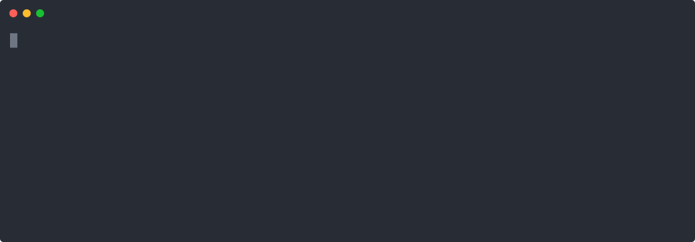
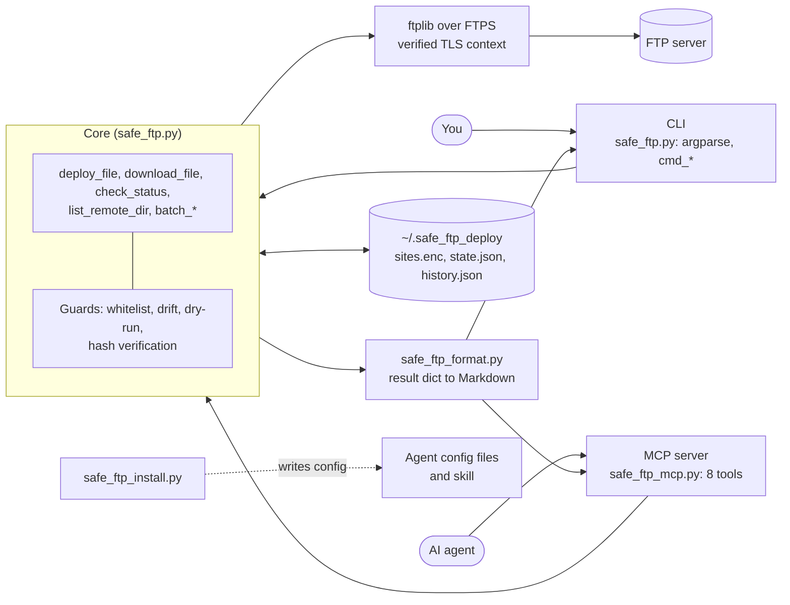

<div align="center">


**FTP deploys you can hand to an AI agent.**<br>
It never deletes, it refuses to overwrite files that changed behind its back, and it does nothing until you say `--execute`.

[](https://github.com/vivekkushalch/safe_ftp/actions/workflows/ci.yml)
[](LICENSE)
[](https://www.python.org/downloads/)
[](https://modelcontextprotocol.io)

[Quick start](#quick-start) ·
[Use with an AI agent](#use-with-an-ai-agent) ·
[How it works](#how-it-works) ·
[Safety model](#safety-model) ·
[Usage](#usage) ·
[Architecture](#architecture) ·
[FAQ](#faq)

</div>

<p align="center">
  
</p>

<sub>Text follows the tool's real messages. Hashes and timestamps are made up.</sub>

## Overview

Safe FTP Deploy replaces the manual FileZilla routine of renaming the old file and uploading the new one. Each deploy renames the live file to a timestamped backup, uploads the new file, then downloads it again and compares hashes. The tool has no delete code path, so a bad deploy leaves the old file on the server under the backup name.

It also ships an MCP server and an agent skill. An agent that deploys through it follows the same rules you do: dry-run first, drift checks, and a directory whitelist the agent cannot change.

What you get:

- A CLI (`safe-ftp-deploy`) for single files and whole folders, in both directions.
- Drift detection. The tool records each file's hash after a deploy and refuses to overwrite a file whose hash has since changed.
- Dry-run by default on every write command, in the CLI and in the MCP tools.
- Credentials encrypted on disk with a master password.
- An MCP server with 8 tools, and a one-command installer for 5 agents.

Plain FTP and FTPS only. SFTP is not supported.

## Quick start

You need [uv](https://docs.astral.sh/uv/getting-started/installation/) and Python 3.10 or newer. It runs on Windows, macOS and Linux.

**1. Install**

```bash
uv tool install git+https://github.com/vivekkushalch/safe_ftp.git
```

**2. Save a site.** Run this in your project folder. You are asked for a master password, the FTP host, port, username and password, and the remote directories the tool may touch.

```bash
safe-ftp-deploy setup-site --name mysite
```

**3. Deploy.** Without `--execute` you get a plan and nothing changes.

```bash
safe-ftp-deploy deploy --local ./index.php --remote /public_html/index.php
safe-ftp-deploy deploy --local ./index.php --remote /public_html/index.php --execute
```

Update with `uv tool upgrade safe-ftp-deploy`.

## Use with an AI agent

Give the agent this tool instead of raw FTP access. The tool enforces the rules, so the agent cannot skip them by asking for something else.

### Install for your agent

Run the command for your agent inside the project folder. Each block has its own copy button.

```bash
safe-ftp-deploy install claude
```

```bash
safe-ftp-deploy install cursor
```

```bash
safe-ftp-deploy install windsurf
```

```bash
safe-ftp-deploy install opencode
```

```bash
safe-ftp-deploy install antigravity
```

```bash
safe-ftp-deploy install all
```

Existing config entries are kept. The command writes these files:

| Agent | MCP config | Guidance |
|---|---|---|
| Claude Code | `.mcp.json` | `.claude/skills/safe-ftp-deploy/SKILL.md` |
| Cursor | `.cursor/mcp.json` | `AGENTS.md` |
| Windsurf | `~/.codeium/windsurf/mcp_config.json` (global) | `AGENTS.md` |
| OpenCode | `opencode.json` | `AGENTS.md` |
| Antigravity | `.agents/mcp_config.json` | `AGENTS.md` |

Restart your agent or reload its MCP servers afterward. To wire it up by hand, add this server entry:

```json
{"mcpServers": {"safe-ftp-deploy": {"command": "safe-ftp-deploy", "args": ["mcp"]}}}
```

### Or let the agent set itself up

Paste this into your agent.

```text
Set up safe-ftp-deploy for yourself.

1. Run: uv tool install git+https://github.com/vivekkushalch/safe_ftp.git
2. Run: safe-ftp-deploy install <claude|cursor|windsurf|opencode|antigravity>
   (pick the one that matches the agent you are), then tell me to restart or
   reload my MCP servers.

Rules whenever you deploy or download over FTP with it:
- Always do a dry-run first (execute=False) and show me the summary_markdown.
- Only run again with execute=True after I confirm.
- Never use force unless I explicitly ask.
- Don't ask me to paste FTP or master passwords into this chat. If no site is
  configured, tell me to run `safe-ftp-deploy setup-site --name <site>` myself.
```

### MCP tools

| Tool | What it does | Writes |
|---|---|---|
| `deploy` | Upload one file | yes |
| `batch_deploy` | Upload a folder | yes |
| `download` | Download one file | local files |
| `batch_download` | Download a folder | local files |
| `status` | Compare a remote file to its last known hash | no |
| `history` | Show past deploys of a file | no |
| `list_remote` | List a remote directory | no |
| `setup_site` | Save a site profile | local config |

Every write tool defaults to `execute=False` and returns a `summary_markdown` field the agent can show you as is. `--insecure-tls` is not available through `setup_site`, so an agent cannot turn certificate checking off.

No MCP in your agent? Call the CLI with `--json` for structured output and leave off `--execute` to get a plan.

## How it works

Every deploy runs the same sequence. Each check can stop it, and nothing is written before the rename step.

```mermaid
flowchart TD
    A([deploy local to remote]) --> B{Local file exists?}
    B -- no --> E1[error]
    B -- yes --> C{Remote path in whitelist?}
    C -- no --> E2[blocked]
    C -- yes --> D[Connect over FTPS, hash the remote file]
    D --> F{Remote already equals local?}
    F -- yes --> N1[no_change]
    F -- no --> G{Hash differs from --expected-hash?}
    G -- yes, no --force --> E3[stale_download]
    G -- no --> H{Hash differs from last deploy?}
    H -- yes, no --force --> E4[drift_detected]
    H -- no --> I{--execute given?}
    I -- no --> N2[dry_run: print the plan]
    I -- yes --> J[Rename remote file to backup]
    J --> K[Upload new file]
    K --> L[Download again and compare hashes]
    L -- mismatch --> E5[upload_verification_failed]
    L -- match --> M[Record hash and history entry]
    M --> S([success])
```

If verification fails, the old file is still on the server under the backup name.

Backups are named `name_DDMMYY_HHMMSS_microseconds.ext`, for example `index_270726_143210_482391.php`. The microseconds keep names unique when a batch backs up many files in the same second.

Downloads use the same model in reverse. A local file that already exists is renamed to a timestamped backup before the new copy is written.

### Result statuses

| Status | Meaning |
|---|---|
| `dry_run` | Nothing was changed. The message describes what would happen. |
| `success` | Changes applied and verified. |
| `no_change` | Local and remote files are identical. |
| `blocked` | The path is outside the site's directory whitelist. |
| `drift_detected` | The server file changed since the last deploy through this tool. |
| `stale_download` | The server file no longer matches the `--expected-hash` you passed. |
| `upload_verification_failed` | The re-downloaded file did not match. The backup is intact. |
| `download_verification_failed` | Same check, for downloads. |
| `error` | Something else went wrong, such as a missing local file. |

## Safety model

| Guarantee | How it is enforced |
|---|---|
| No file is deleted | There is no delete call in the code. Replacing a file means renaming it. |
| No silent overwrite | The remote hash is compared with the hash recorded at the last deploy. A mismatch stops the deploy unless you pass `--force`. |
| No surprise writes | Writes need `--execute` in the CLI and `execute=True` in MCP. |
| No bad uploads | Each upload is downloaded again and hashed. |
| Limited reach | Remote paths must sit under a whitelisted directory. The match is on path boundaries, so `/images` does not match `/images2`. |
| Credentials encrypted | Fernet (AES) with a PBKDF2-SHA256 key at 480,000 iterations. The master password is not stored. |
| Certificates checked | FTPS verifies the server certificate and hostname unless the site was saved with `--insecure-tls`. |

### Limits to know about

- An empty whitelist means the whole site is allowed. Always set `--allowed-dirs`.
- The first deploy of a file has no recorded hash, so there is nothing to drift from. `status` reports this as `no_history`. For a download, edit, deploy loop, pass `--expected-hash` to catch changes made in between.
- Backups pile up on the server. The tool never removes them, so you clean them out yourself.
- The `.ftpconfig` convenience file stores the master password in plain text. See [Configuration](#configuration).

## Usage

`--name` is optional once `setup-site` has run in a folder, because it defaults to the site in `.ftpconfig`.

| Command | Purpose |
|---|---|
| `setup-site` | Add or update an encrypted site profile |
| `deploy` | Upload one file |
| `batch-deploy` | Upload a folder |
| `download` | Download one file |
| `batch-download` | Download a folder |
| `status` | Check one remote file for drift |
| `history` | Show past deploys of a file |
| `list` | List a remote directory |
| `mcp` | Start the MCP server on stdio |
| `install` | Add the MCP server and guidance to an agent |

Run `safe-ftp-deploy <command> --help` for every flag.

### Deploy

```bash
safe-ftp-deploy deploy --local ./index.php --remote /public_html/index.php --execute -m "fix checkout redirect"
safe-ftp-deploy batch-deploy --local-dir ./site --remote-dir /public_html --execute
```

`-m` attaches a note that `history` shows later. `--force` skips the drift and stale checks. Use it only after you have looked at the server version.

### Filter a batch

`--include` and `--exclude` take comma-separated glob patterns and work on `batch-deploy`, `batch-download` and `list`.

```bash
safe-ftp-deploy batch-deploy \
  --local-dir ./site --remote-dir /public_html \
  --include "*.php,*.css,*.js" \
  --exclude "vendor/*,*.log,cache/*" \
  --execute
```

### Download

```bash
safe-ftp-deploy download --remote /public_html/config.php --local ./config.php --execute
safe-ftp-deploy batch-download --remote-dir /public_html --local-dir ./site_backup --execute
```

### Inspect

```bash
safe-ftp-deploy status --remote /public_html/index.php
safe-ftp-deploy history --remote /public_html/index.php --limit 5
safe-ftp-deploy list --remote-dir /public_html --recursive --sort modified --reverse
```

## Configuration

### Setting up a site

Interactive setup is shown in the [quick start](#quick-start). For scripts, pass every field and keep passwords out of shell history by using environment variables.

```bash
export SAFE_FTP_FTP_PASSWORD="..."
export SAFE_FTP_MASTER_PASSWORD="..."

safe-ftp-deploy setup-site --name mysite --non-interactive \
  --host ftp.example.com --port 21 --username myuser \
  --use-tls --allowed-dirs "/public_html/,/public_html/blog/"
```

`--ftp-password` and `--master-password` also exist, but they show up in shell history and process lists.

### Import from FileZilla

```bash
safe-ftp-deploy setup-site --name mysite --from-filezilla ./export.xml
```

Use a Site Manager XML export that contains exactly one `<Server>`. It fills in host, port, username, password and TLS. You are still asked for the directory whitelist unless you pass `--allowed-dirs`. Exports protected by a FileZilla master password (`encoding="crypt"`) cannot be read. Re-export without one, or pass `--ftp-password`.

### TLS

FTPS connections verify the server certificate and hostname. If your host uses a self-signed or mismatched certificate and you trust it, save the site with `--insecure-tls`.

```bash
safe-ftp-deploy setup-site --name mysite --insecure-tls
```

This leaves the connection open to interception, so use it only for hosts you trust.

### Files on disk

| Path | Contents |
|---|---|
| `~/.safe_ftp_deploy/sites.enc` | Encrypted site profiles, mode `0600` |
| `~/.safe_ftp_deploy/salt.bin` | Salt for the key derivation |
| `~/.safe_ftp_deploy/state.json` | Last deployed hash per site and remote path. Hashes only |
| `~/.safe_ftp_deploy/history.json` | Append-only deploy log: time, note, hashes, backup name |
| `./.ftpconfig` | Optional. Default site name and master password, in plain text |

### `.ftpconfig`

`setup-site` writes `.ftpconfig` in the current folder. Line 1 is the default site name and line 2 is the master password. With it present you skip the password prompt and the `--name` flag in that folder. Delete it to go back to prompting.

> [!WARNING]
> The file is plain text, so it gives up the "master password never touches disk" property. Do not back it up, copy it off the machine, or upload it to the server. Add `.ftpconfig` to your `.gitignore`.

An old `.masterpwd` file is migrated into `.ftpconfig` the next time you run `setup-site`.

## Architecture

The CLI and the MCP server are two front ends over one core. Both call the same functions, so the safety rules cannot differ between them.



### Modules

| File | Lines | Role |
|---|---|---|
| `safe_ftp.py` | ~1500 | Core operations, encrypted storage, FTP connection, argparse CLI |
| `safe_ftp_mcp.py` | ~290 | MCP server. Thin `_*_impl` functions wrap the core and add `summary_markdown` |
| `safe_ftp_format.py` | ~250 | Turns result dicts into Markdown. The CLI renders it with `rich`, MCP returns it as text |
| `safe_ftp_install.py` | ~300 | `install` command. Merges MCP entries into agent configs and writes guidance |
| `skill/safe-ftp-deploy/SKILL.md` | | The agent skill, copied into `.claude/skills` for Claude Code |
| `tests/` | | 17 test modules. No real FTP server is needed |

### Design notes

- Core functions return a result dict with a `status` instead of raising for expected problems. The CLI and the MCP server both get a structured result, so an agent never has to parse an exception.
- Remote paths are built as POSIX strings, never with `os.path.join`, so a Windows client does not send backslashes to the server.
- Site profiles are one encrypted JSON blob. The key comes from the master password and a random salt. State and history are separate plain files because they hold only hashes and notes.
- The core keeps no connection between calls. Each operation connects, works and quits, which keeps the MCP server stateless.

## FAQ

**Can it delete files?**
No. Replaced files are renamed to timestamped backups.

**What happens when the server file changed since my last deploy?**
You get `drift_detected` and nothing is written. Look at the server version, then re-run with `--force` if you still want to overwrite it.

**Can an agent get around the guardrails?**
Not through the tool. The whitelist, drift check and dry-run default are enforced inside the core. An agent that can run shell commands on your machine can still read your files, so treat `.ftpconfig` and `~/.safe_ftp_deploy` as sensitive.

**Does it support SFTP?**
No. It uses Python's `ftplib`, so FTP and FTPS only.

**How do I undo a deploy?**
Run `history --remote <path>` to find the backup name, then rename the backup back on the server in your FTP client. A rollback command does not exist yet.

## Development

```bash
git clone https://github.com/vivekkushalch/safe_ftp.git
cd safe_ftp
uv sync
uv run pytest
```

Read [CONTRIBUTING.md](CONTRIBUTING.md) before opening a pull request. Release notes are in the [CHANGELOG](CHANGELOG.md).

## Security

Report vulnerabilities privately as described in [SECURITY.md](SECURITY.md).

## License

[MIT](LICENSE)
